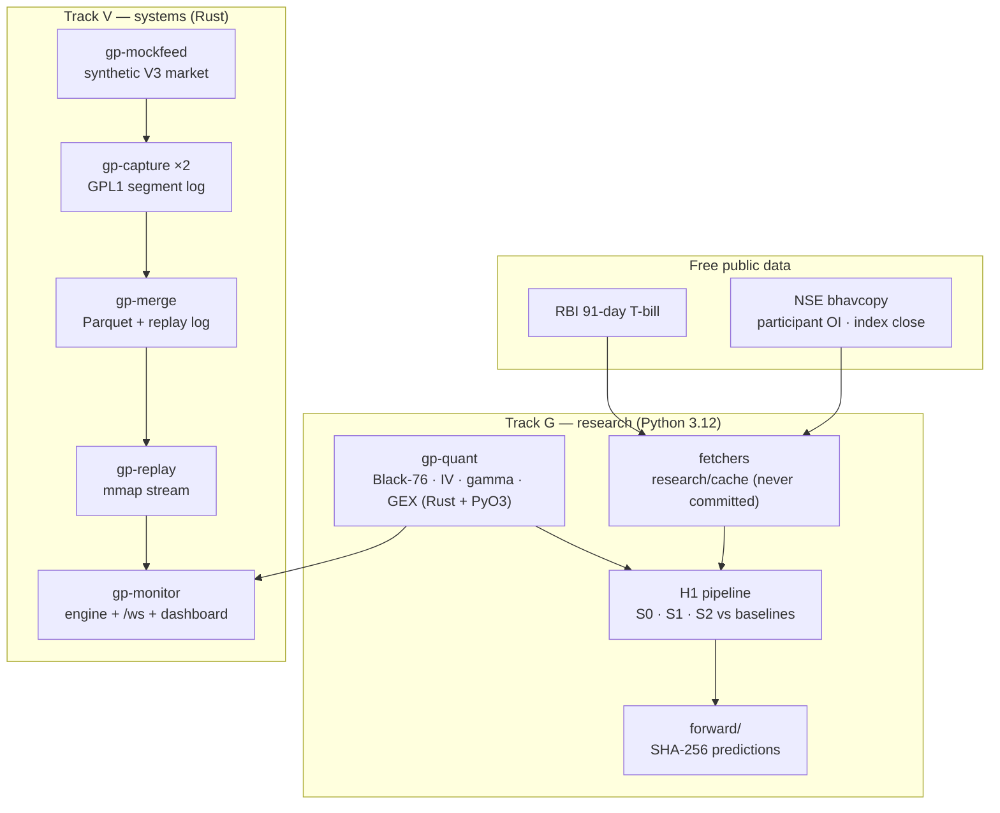
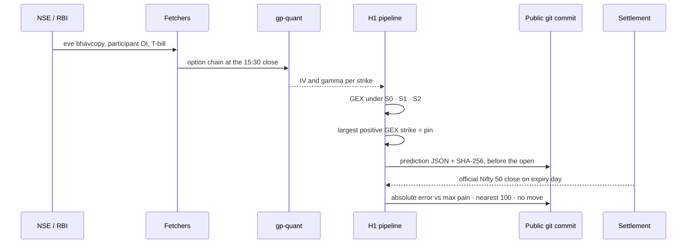

# GammaPin

**The first open, pre-registered test of whether gamma exposure predicts Nifty expiry-day moves — on free public data.**

[](.github/workflows/ci.yml)
[](Cargo.toml)
[](research/requirements.txt)
[](PREREGISTRATION.md)
[](docs/RESULTS.md)
[](LICENSE)

About 59% of Indian index-options turnover is in same-day-expiry contracts, and
traders rely on GEX charts whose claims nobody has tested. GammaPin fixes its
hypotheses before looking at the data, compares the US sign convention with
India's participant-wise positioning, and forward-tests on expiry day with a
public, timestamped prediction. No broker account: NSE and RBI files only.

**Short answer: no.** On 94 Nifty weekly expiries, the strike with the largest
positive GEX at the expiry-eve close is never significantly better a guess of the
settlement than the best simple baseline. Under the US sign convention it is significantly worse.

---

## Contents

| Section | |
|---|---|
| [What it does](#what-it-does) | The research and the systems, by area |
| [Architecture](#architecture) | Research pipeline and the capture design |
| [How a prediction travels](#how-a-prediction-travels) | Eve close to scored forecast |
| [Results](#results) | The pre-registered test, train and test |
| [Quick start](#quick-start) | Build, bind, test |
| [Project status](#project-status) | Both tracks, and the scope change |
| [Design decisions](#design-decisions) | The tradeoffs, and why |
| [Repository layout](#repository-layout) | Where things live |
| [Documentation](#documentation) | Which file answers which question |
| [Team](#team) | Who built it |

---

## What it does

| Area | Capabilities |
|---|---|
| **Pricing** | Black-76, implied volatility, gamma and GEX in Rust, exposed to Python through PyO3 |
| **Data** | Fetchers for NSE F&O bhavcopy, participant OI, index close and RBI 91-day T-bill cut-offs |
| **Hypothesis H1** | Gamma pinning under three sign conventions (S0, S1, S2) against max pain, nearest 100 and no move |
| **Statistics** | Moving-block bootstrap CIs and paired Wilcoxon tests with a Bonferroni bar |
| **Forward test** | Predictions published with a SHA-256 in a public commit before the session, then scored |
| **Capture** | WebSocket capture to an append-only, CRC-checked log on two redundant nodes |
| **Merge & replay** | De-duplicated Parquet, a memory-mapped replay log and a stream shared by live and replay |
| **Monitor** | Live/replay engine, a `/ws` server and a browser dashboard |

### Data

| Data | Source | Used for |
|---|---|---|
| F&O daily bhavcopy | NSE archives | Option chain at the eve close: price and OI per strike |
| Participant OI | NSE | S1 and S2 sign conventions |
| Index close | NSE `ind_close_all` | Settlement (the target) |
| 91-day T-bill cut-off | RBI press releases | Risk-free rate |

---

## Architecture

Two tracks meet at a shared contract. **Track G** turns public end-of-day files
into a tested claim; **Track V** is the low-latency capture stack, built and
proven on a synthetic market.



### The capture design (built, not deployed)

Every live NSE feed needs a broker or vendor account with SEBI KYC, so live
capture was dropped on 17 Oct 2026. The systems were still built and tested
against `gp-mockfeed`, a synthetic market on the same Upstox V3 protocol. No real
tick was captured.

```
            Upstox Market Data Feed V3 (WebSocket, Protobuf)
                 │ conn 1                      │ conn 2
        ┌────────▼────────┐          ┌─────────▼────────┐
        │ Node A (4090)   │          │ Node B (4090)    │
        │ gp-capture      │          │ gp-capture       │   raw frames → GPL1 log
        └────────┬────────┘          └─────────┬────────┘
                 └──────────────┬──────────────┘  (LAN, chrony-synced clocks)
                       ┌────────▼─────────────────────────┐
                       │ Node C (RTX 4500 Ada)            │
                       │ gp-merge → Parquet + replay log  │
                       │ gp-monitor (live engine + UI)    │
                       │ research/ (Python)               │
                       └──────────────────────────────────┘
```

---

## How a prediction travels



The prediction is committed **before** the market opens, so the score cannot be
fitted to the outcome.

---

## Results

Everything was fixed in [PREREGISTRATION.md](PREREGISTRATION.md) and tagged
`prereg-v1` before the test set was opened. The test set was run once.
Chronological split: 66 training expiries to 30 Mar 2026, 28 test expiries from
7 Apr 2026.

| Prediction | Train MAE | Test MAE |
|---|---:|---:|
| pin S0 (US convention) | 201.6 | 227.8 |
| pin S1 (FII + Pro writers) | 165.2 | 153.5 |
| pin S2 (opposite of Clients) | 166.5 | 153.5 |
| max pain | 160.3 | **144.8** |
| nearest 100 | 146.2 | 154.3 |
| no move | **145.4** | 154.7 |

| Convention | Split | Pin − best baseline | 95% CI | Wilcoxon p | Supports H1 |
|---|---|---:|---|---:|---|
| S0 | train | +56.2 | [+28.1, +80.6] | 0.0009 | No, significantly worse |
| S1 | train | +18.9 | [−1.6, +51.0] | 0.135 | No |
| S2 | train | +20.1 | [+0.4, +51.9] | 0.086 | No |
| S0 | test | +83.0 | [+45.3, +127.0] | 0.0079 | No, significantly worse |
| S1 | test | +8.7 | [−41.3, +35.0] | 0.793 | No |
| S2 | test | +8.7 | [−41.3, +35.0] | 0.793 | No |

**H1 is not supported.** No convention meets the bar on either split, and every
difference against the split's best baseline is positive. **H2** (volatility regime) is not tested: it needs
intraday history that no free source provides. Full write-up:
[docs/RESULTS.md](docs/RESULTS.md).

---

## Quick start

> Running the expiry-day forward test? Follow [ops/RUNBOOK.md](ops/RUNBOOK.md)
> and [forward/README.md](forward/README.md). This is only the build.

```bash
# 1 — Rust workspace (stable toolchain, 2024 edition)
cargo test --workspace

# 2 — Python bindings for the pricing core
cd crates/gp-quant && maturin develop && cd ../..

# 3 — research pipeline and its tests
cd research && pip install -r requirements.txt && pytest
```

Raw NSE files are never committed (`research/cache/` is ignored); the fetchers
download them from NSE.

---

## Project status

The research question is answered on history; the forward test is live. Track V
finished every system on the mock feed after the scope change.

| Track | Scope | Status |
|---|---|:---:|
| G0–G4 | Contracts, pricing core, historical data, GEX engine, research pipelines | ✅ (G0.13 branch protection open) |
| G5 | Dashboard on `gp-monitor`'s live `/ws`, fed by the mock market | ✅ |
| G6 | Validation and model freeze (`freeze-v1`) | ✅ |
| G7 | Test set, forward predictions, scoring, final write-up | ✅ test set · ✅ expiry-1 scored · ⏳ expiry-2 and final write-up |
| V0–V3 | Capture foundation, merge, replay | ✅ on the mock feed |
| V5–V6 | Live engine, monitor server, hardening | ✅ on the mock feed |
| V4, V7 | Live expiry capture | ✂️ dropped — needs a KYC'd feed |

### Performance targets

| Metric | Target | Result |
|---|---|---|
| Data loss when one node fails | 0 frames (60 s network cut) | ✅ 0, simulated |
| Capture throughput per node | ≥ 50k msg/s sustained | ✅ 291k at 782 B |
| Full-chain recompute (≤ 1,500 contracts) | < 5 ms on one core | ✅ 2.4 ms |
| Feed-to-dashboard latency | p99 < 250 ms | ✅ 156 ms, mock feed |
| Replay speed | ≥ 1M events/s | ✅ 11.0M |
| Replay determinism | SHA-256 identical across runs | ✅ |

### Forward test

| Expiry | Published | Pin S0 | Pin S1 | Pin S2 | Max pain | No move | Settlement |
|---|---|---:|---:|---:|---:|---:|---|
| 19 Oct 2026 | 18 Oct, `c5827627…` | 23,200 | 23,000 | 23,000 | 23,050 | 23,103.5 | 22,888.95 |
| 27 Oct 2026 | pending | | | | | | |

Two forward expiries cannot confirm or reject H1. They show the pipeline running
live and in public, without hindsight.

### What CI proves on every push

| Job | Proves |
|---|---|
| `rust` | `cargo fmt` is clean, `clippy` passes with warnings as errors, and the whole workspace tests green |
| `python` | The research package installs with the `gp-quant` bindings and its pytest suite passes |

---

## Design decisions

**Pre-register, then look.** Hypotheses, metrics, baselines and the success bar
were frozen and tagged before the test set was opened. A GEX claim tested after
seeing the outcomes would prove nothing.

**Compare to the best baseline, not the weakest.** A pin has to beat whichever
of max pain, nearest 100 or no move did best on the same expiries — and do it
with a bootstrap CI below zero *and* a Bonferroni-corrected Wilcoxon test.

**Test the sign convention, don't assume it.** The US convention (dealers long
calls, short puts) cannot be confirmed from NSE data, so it is one of three
candidates alongside two built from NSE's participant-wise positioning.

**Free data only.** Anyone can rerun the result. The price was H2 and live
capture, both of which need data no free source provides.

**Build the systems anyway, and say what they ran on.** Every capture, merge and
replay number is measured on the synthetic feed and labelled as such.

**Analytics, not trading advice.**

---

## Repository layout

```
.
├── crates/
│   ├── gp-quant/      Black-76, IV, gamma, GEX (Rust + PyO3)
│   ├── gp-log/        GPL1 append-only, CRC-checked segment log
│   ├── gp-feed/       Upstox V3 protobuf decoder, instrument master, synthetic market
│   ├── gp-capture/    WebSocket capture with gaps, reconnects, token reload; gp-mockfeed
│   ├── gp-merge/      two nodes' logs → de-duplicated Parquet, replay log, coverage report
│   ├── gp-replay/     memory-mapped replay log, stream shared by live and replay
│   └── gp-monitor/    live/replay engine, /ws server, dashboard page
├── research/          data fetchers, H1 and H2, forward test (Python 3.12)
├── forward/           published forward-test predictions and scores
├── proto/             Upstox V3 protobuf definitions
├── ops/               runbook, systemd units and chrony config for capture nodes
└── docs/              results, contracts, systems, settlement, novelty
```

---

## Documentation

| Question | File |
|---|---|
| *Does GEX pin Nifty?* | [docs/RESULTS.md](docs/RESULTS.md) |
| *What was fixed before the test?* | [PREREGISTRATION.md](PREREGISTRATION.md) |
| *Has anyone tested this before?* | [docs/NOVELTY.md](docs/NOVELTY.md) |
| *What counts as the settlement?* | [docs/SETTLEMENT.md](docs/SETTLEMENT.md) |
| *How were the capture systems tested?* | [docs/SYSTEMS.md](docs/SYSTEMS.md) |
| *What do the crates exchange?* | [docs/CONTRACTS.md](docs/CONTRACTS.md) |
| *Which models were frozen?* | [docs/MODELS_FINAL.md](docs/MODELS_FINAL.md) |
| *How do I run expiry day?* | [ops/RUNBOOK.md](ops/RUNBOOK.md) · [forward/README.md](forward/README.md) |
| *Who owns which task?* | [CONTRIBUTING.md](CONTRIBUTING.md) |

---

## Team

| Member | Focus |
|---|---|
| **Guru R Bharadwaj** | Track G — pricing core, historical data, GEX engine, research pipelines, dashboard, write-up |
| **Vivian Sobers** | Track V — capture, merge, replay, the monitor server and the capture nodes |

The two tracks meet at the contracts in [docs/CONTRACTS.md](docs/CONTRACTS.md);
see [the split](CONTRIBUTING.md#how-the-split-works).

---

## License

[MIT](LICENSE).
